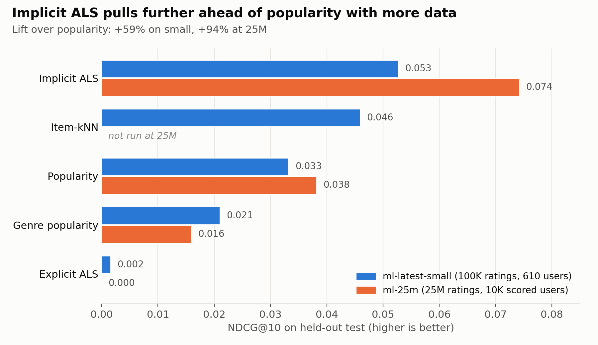
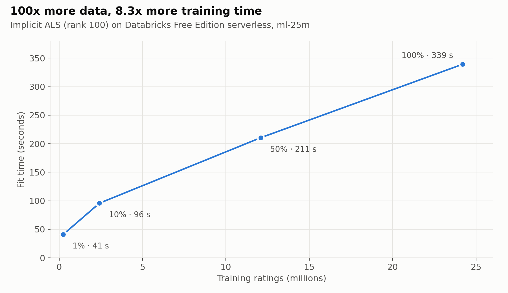

# Movie Recommender with Offline Evaluation

How well does collaborative filtering (Spark ALS) rank the movies a user actually watches next, compared with simple baselines? I built it on 100K MovieLens ratings, then scaled the same notebooks to 25 million ratings on Databricks.

**[Case study](https://chayangulgulia.vercel.app/work/movie-recs)** · **[Notebooks with results](https://chayanjn24.github.io/movie-recommender/)**



## Business question
Which recommender should a catalogue team ship, judged on **ranking quality** (are the right movies near the top of the list?) rather than rating error alone, and what does it cost in catalogue coverage and popularity bias?

## Headline results (ml-25m, 25M ratings)
- **Implicit ALS beats "recommend the most popular movies" by 94%** on NDCG@10 (0.0742 vs 0.0382). On the small dataset the lead was 59%, so it grows with more data.
- **Validation now predicts test.** At 25M, implicit ALS scores 0.0721 on validation and 0.0742 on test. On the small dataset every model scored about a fifth lower on test than on validation (implicit ALS 0.0695 → 0.0527, popularity 0.0420 → 0.0332), so 610 users made a noisy tuning guide.
- **The best rating predictor is the worst recommender.** Explicit ALS has the lowest error (RMSE 0.887) but NDCG@10 of 0.000: its top 10 are obscure movies from the long tail (average popularity percentile 0.09).
- **Training scales sub-linearly.** 100x more data took 8.3x longer to fit (41 s → 339 s on Free Edition serverless).
- Implicit ALS recommends 3.8% of the catalogue across users, against 0.32% for popularity.

## Data
[MovieLens](https://grouplens.org/datasets/movielens/) by GroupLens Research. The data is not in this repo (its licence does not allow redistribution); `01_profile` downloads it.

| | `ml-latest-small` (development) | `ml-25m` (scale run) |
|---|---|---|
| Download | [ml-latest-small.zip](https://files.grouplens.org/datasets/movielens/ml-latest-small.zip) (978 KB) | [ml-25m.zip](https://files.grouplens.org/datasets/movielens/ml-25m.zip) (262 MB) |
| Ratings | 100,836 | 25,000,095 |
| Users | 610 | 162,541 |
| Movies rated | 9,724 | 59,047 |
| Sparsity | 98.30% | 99.74% |
| Top 10% of movies hold | 60.0% of ratings | 94.0% of ratings |

Columns, date ranges and every table written are in the [data dictionary](docs/data_dictionary.md).

## Approach
1. **Load and profile** (`01_profile`): raw CSVs into a Unity Catalog Volume, then Delta tables; sparsity, data quality, user activity, long-tail popularity.
2. **Temporal split per user** (`02_split`): each user's last 5 ratings are test, the 5 before are validation, the rest train. This mirrors "what will this user watch next?" and avoids training on a user's future.
3. **Baselines** (`03_baselines`): global popularity, genre-weighted popularity, item-kNN (cosine, small dataset only).
4. **ALS** (`04_als`): explicit (tuned on validation RMSE) and implicit (tuned on validation NDCG@10). The winners are refit on train + validation and scored once on test.
5. **Metrics** (`00_common`): Precision, Recall, NDCG and MAP at 10, catalogue coverage and popularity bias. Every held-out movie counts as relevant.
6. **Scale run**: the same notebooks on ml-25m, plus fit time on 1%, 10%, 50% and 100% of the data.

## Full results
Test set, top 10 recommendations per user. NDCG@10 is the main metric.

**ml-25m**: models trained on all 24.2M train + validation ratings; scored on a fixed sample of 10,000 users.

| Model | NDCG@10 | Recall@10 | Precision@10 | MAP@10 | Coverage | Test RMSE |
|---|---|---|---|---|---|---|
| Implicit ALS (rank 100, reg 0.1, alpha 0.5) | **0.0742** | 8.97% | 4.48% | 0.0373 | 3.80% | — |
| Popularity | 0.0382 | 4.56% | 2.28% | 0.0183 | 0.32% | — |
| Genre popularity | 0.0159 | 1.85% | 0.93% | 0.0069 | 0.81% | — |
| Explicit ALS (rank 10, reg 0.1) | 0.0000 | 0.00% | 0.00% | 0.0000 | 1.48% | 0.887 |

**ml-latest-small**: all 610 users.

| Model | NDCG@10 | Recall@10 | Precision@10 | MAP@10 | Coverage | Test RMSE |
|---|---|---|---|---|---|---|
| Implicit ALS (rank 100, reg 0.1, alpha 1) | **0.0527** | 6.69% | 3.34% | 0.0250 | 9.76% | — |
| Item-kNN (20 neighbours) | 0.0459 | 5.74% | 2.87% | 0.0212 | 5.68% | — |
| Popularity | 0.0332 | 3.64% | 1.82% | 0.0162 | 1.27% | — |
| Genre popularity | 0.0210 | 2.43% | 1.21% | 0.0096 | 2.44% | — |
| Explicit ALS (rank 10, reg 0.1) | 0.0016 | 0.20% | 0.10% | 0.0007 | 6.00% | 0.971 |

Coverage is not comparable between the two tables: the 25M catalogue is 6x larger and only 10,000 users are scored.



| Share of train + val | Ratings | Fit time |
|---|---|---|
| 1% | 241,452 | 40.9 s |
| 10% | 2,417,757 | 95.8 s |
| 50% | 12,091,711 | 210.6 s |
| 100% | 24,187,390 | 339.2 s |

Times include serverless start-up overhead, which dominates the smallest fit.

## Notebooks
Code is in [`notebooks/`](notebooks) (Databricks source format). To read them with their output from the 25M run, no login needed:

[01 · Profile](https://chayanjn24.github.io/movie-recommender/notebooks/01_profile.html) · [02 · Split](https://chayanjn24.github.io/movie-recommender/notebooks/02_split.html) · [03 · Baselines](https://chayanjn24.github.io/movie-recommender/notebooks/03_baselines.html) · [04 · ALS](https://chayanjn24.github.io/movie-recommender/notebooks/04_als.html) · [00 · Shared helpers](https://chayanjn24.github.io/movie-recommender/notebooks/00_common.html)

The HTML files are also in [`docs/notebooks/`](docs/notebooks).

## How to run
**On Databricks** (Free Edition works):
1. In your workspace: **Workspace → Create → Git folder**, paste `https://github.com/chayanjn24/movie-recommender`. Or import the files in `notebooks/` into one folder.
2. Open `01_profile`, run the first cell, and choose `small` or `25m` in the **Dataset** dropdown at the top.
3. Run `01_profile` → `02_split` → `03_baselines` → `04_als`, keeping the same dataset choice in each.

`01_profile` creates the schema and Volume and downloads the data. Each dataset gets its own schema (`movielens`, `movielens_25m`).

## Design choices
- **Top-N without `recommendForAllUsers`.** It fails on serverless with Unity Catalog, so top-10 lists are computed from the ALS user and item factors with chunked NumPy dot products, excluding movies the user already rated.
- **25M compromises to fit Free Edition.** Models train on all ratings, but metrics are computed for a fixed hash sample of 10,000 users. Item-kNN is skipped (its self-join grows with the square of user history), and the ALS grid covers only the neighbourhood of the small-data winners.
- **Relevance = watched next.** Every held-out rating counts, not only 4 and 5 stars, because the question is what the user will watch.

## Limitations
- Offline metrics are a proxy; they do not measure how users react to recommendations.
- MovieLens users are self-selected, active raters (at least 20 ratings each). Brand-new users and new movies are not covered: 3.6% of small-data test ratings are for movies never seen in training, which no collaborative model can recommend.
- The 25M grid is small, and item-kNN was not run at 25M, so the strongest small-data baseline is missing from the 25M comparison.
- Fit times come from one run on shared serverless compute and will vary.

## Next steps
- Cold-start fallback: popularity or genre popularity for users and movies the model has not seen.
- Item-kNN at 25M, using approximate nearest neighbours instead of the exact self-join.
- A wider 25M grid (rank, alpha, iterations) now that validation predicts test reliably.
- A small demo: pick a user, see their history next to their recommendations.

## Repo layout
```
notebooks/            the pipeline: Databricks notebooks 00–04
docs/
├── data_dictionary.md
├── images/           charts used in this README
└── notebooks/        HTML exports of the notebooks with their 25M output
```
